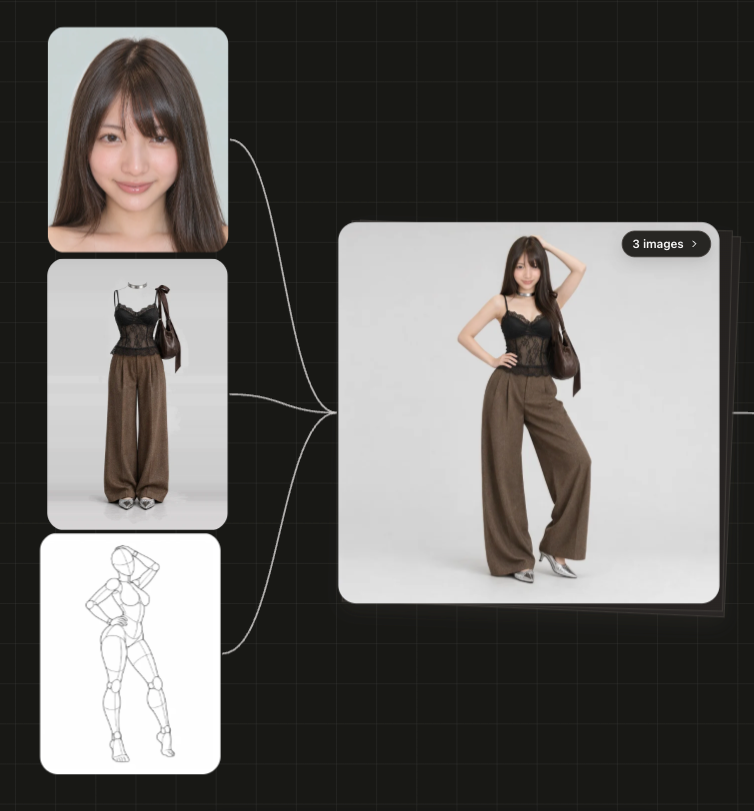

# AI Girls Gallery

[English](README.md) | [中文](README.zh.md) | **日本語**

AI画像・動画制作のための、日本語・英語・中国語の3言語対応リファレンスライブラリです。顔・衣装・ポーズ・ポーズ深度マップの4つの無料リファレンス集を1つのページにまとめ、オンラインでもオフラインでも閲覧できます。

**オンラインで見る：** https://walkershadow.github.io/ai-girls-gallery/

**作ってみる：** [AI Creator](https://ai-creator.xprismai.com/) で、これらのリファレンスを組み合わせて画像を生成できます。

## 作例

このライブラリの顔・衣装・ポーズを1枚ずつ組み合わせ、人物を一貫させて生成した画像です。



## 収録内容

| ギャラリー | 内容 | 出典 |
|---|---|---|
| 顔データベース | AI生成の架空の人物の顔 1,499枚（フェイス 893・スタイリング 606）。髪の長さで絞り込み、ダウンロード Top10 あり | [AIモデル顔データベース](https://ai-portrait-gallery.pages.dev/) |
| 衣装集 | 人物の入っていない衣装だけの画像 1,407枚、8カテゴリ（季節・ランジェリー・パーティ・水着・セクシー） | [COSTUME-DB-01](https://ai-costume-gallery.pages.dev/) |
| ポーズ集 | 288ポーズ × 5アングル（1,439枚）、顔なしグレーマネキンの線画 | [POSE-DB-01](https://ai-pose-gallery.pages.dev/) |
| depthポーズ集 | 同じ288ポーズ × 5アングルの深度マップ（1,439枚）、白いほど手前 | [POSE-DB-02](https://ai-pose-depth-gallery.pages.dev/) |

機能：言語切替（EN / 中文 / 日本語）、3言語どれでも検索、分類で絞り込み、詳細表示とアングル切替。「このライブラリについて」で各元サイトの使い方のヒントとルールを確認できます。

**ミックス：** 顔・衣装・ポーズを1つずつ組み合わせてプロンプトを作ります。

- 閲覧中に「ミックスに入れる」で選ぶか、ランダムに選びます。ロックした枠は変わりません。
- ポーズは線画・depth・両方から選べ、5つのアングルを切り替えられます。
- プロンプトは日本語・英語・中国語で作れます。対話型モデル（GPT・Gemini・Seedream など）向けの指示文か、SD / ComfyUI 向けの英語タグ（IP-Adapter / ControlNet の設定例付き）を選べます。
- 1枚しか読み込めないツール向けに、番号付きの参照ボードを保存できます。
- 組み合わせごとにリンクがあります。

ポーズ名の一部は、成人向け・密着系のポーズを表しています。登場するのはすべてマネキン、またはAI生成の架空の人物です。

## 使い方

- **オンライン：** 上のリンクを開きます。このリポジトリにはサムネイルだけを収録しています。詳細の大きな画像と「元サイズのPNGをダウンロード」は、制作者の元サイトから直接読み込みます（新しいタブで開いて保存してください）。
- **ローカル：** リポジトリをクローンし、ブラウザで `index.html` を開くだけです。サーバーもビルドも不要です。`portrait/img/full/`・`costume/img/`・`costume/png/`・`pose/img/`・`depth/img/` に元画像を置いておくとそちらを優先し、なければ元サイトから読み込みます。

```bash
git clone https://github.com/walkershadow/ai-girls-gallery.git
```

元画像はこのリポジトリに含めておらず、まとめて配布することもありません。元サイトから1枚ずつ取得してください。

## 著作権と許諾

**画像の権利はこのリポジトリにはありません。** すべての画像は各制作者に帰属し、許諾を得て転載しています。

| ギャラリー | 制作者 | 元サイトの規約 |
|---|---|---|
| 顔データベース | あぎ（[@agi_aibusi](https://x.com/agi_aibusi)） | CC0 1.0。商用利用・編集・参考利用OK。画像データそのものの再配布・転載はご遠慮くださいとのお願いがあります。 |
| 衣装集・ポーズ集・depthポーズ集 | ギア（[@giaaibusi](https://x.com/giaaibusi)） | 作品制作での利用は無償（商用OK）。画像データの再配布・転載・再販・一括ダウンロードは禁止。 |

両制作者から、このリポジトリの所有者がここに画像を転載する許諾を得ています。**この許諾はこのリポジトリに限ったもので、利用者に引き継がれるものではありません。** 画像を使うときは：

- 各元サイトの規約に従い、ご自身の制作の参考として使ってください。
- このリポジトリやそのミラーから、画像を一括ダウンロード・再配布・転載・販売しないでください。
- 実在人物や未成年を表す用途、なりすまし、公序良俗に反する用途には使わないでください。

人物・衣装・マネキンはすべてAI生成の架空のものです。衣装画像は文字から画像を生成する方法（t2i）で作られ、実在の商品写真は使っていません。元サイトは画像を無保証で提供しています。

このリポジトリのページのコード・翻訳・スクリプトは [walkershadow](https://github.com/walkershadow) によるものです。各ギャラリーの「このライブラリについて」では、元サイトのルールを3言語で全文掲載しています。

**制作者の方へ：** 内容の修正・削除をご希望の場合は issue でお知らせください。速やかに対応します。

## 構成

```
index.html              ページ（file:// でも GitHub Pages でも動作）
assets/app.js           ページの処理
assets/mix.js           ミックス：プロンプトと参照ボード
data/                   生成したメタデータ・翻訳・UI文言
source/                 元サイトのページとメタデータ
tools/build.py          source/ と tools/i18n_*.tsv から data/*.js を再生成
tools/i18n_*.tsv        翻訳表（日本語 → 中国語・英語）
portrait/ costume/ pose/ depth/   画像
```

翻訳を直すときは `tools/i18n_*.tsv` を編集し、`python3 tools/build.py` を実行します。
