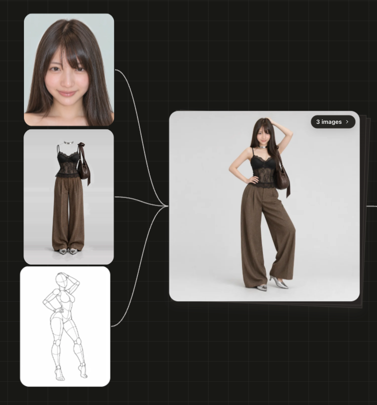

# AI Girls Gallery

**English** | [中文](README.zh.md) | [日本語](README.ja.md)

A trilingual (English / Chinese / Japanese) reference library for AI image and video creation. It brings together four free reference galleries — faces, costumes, poses and pose depth maps — in one page that works online and offline.

**Online:** https://walkershadow.github.io/ai-girls-gallery/

**Try it:** combine these references in [AI Creator](https://ai-creator.xprismai.com/) to generate your own images.

## Example

A face, an outfit and a pose from this library, combined into one consistent image:



## What's inside

| Gallery | Content | Source |
|---|---|---|
| Faces | 1,499 AI-generated fictional faces (893 Face, 606 Styling), filtered by hair length, with a Top 10 | [AI Model Face Database](https://ai-portrait-gallery.pages.dev/) |
| Costumes | 1,407 outfit-only images across 8 categories (seasons, lingerie, party, swimwear, sexy) | [COSTUME-DB-01](https://ai-costume-gallery.pages.dev/) |
| Poses | 288 poses × 5 angles (1,439 images), faceless grey mannequin line art | [POSE-DB-01](https://ai-pose-gallery.pages.dev/) |
| Depth poses | Depth maps of the same 288 poses × 5 angles (1,439 images); whiter means closer | [POSE-DB-02](https://ai-pose-depth-gallery.pages.dev/) |

Features: switch language (EN / 中文 / 日本語), search in any of the three languages, filter by category, open details with angle switching, and read each source site's tips and rules in the "About" panel.

Some pose names describe adult and intimate poses. All figures are mannequins or fictional AI-generated people.

## Use it

- **Online:** open the link above. This repository only contains thumbnails. The detail view and the "Download original PNG" button load the original directly from the creator's site (open it in a new tab, then save).
- **Locally:** clone the repository and open `index.html` in a browser. No server or build step is needed. If you keep original images under `portrait/img/full/`, `costume/img/`, `costume/png/`, `pose/img/` or `depth/img/`, the page uses them first and falls back to the source site otherwise.

```bash
git clone https://github.com/walkershadow/ai-girls-gallery.git
```

Original images are not in this repository and are not repackaged anywhere. Get them one at a time from the source sites.

## Copyright and permission

**The images are not ours.** All images belong to their original creators and are republished here with their permission:

| Gallery | Creator | Terms on the source site |
|---|---|---|
| Faces | Agi ([@agi_aibusi](https://x.com/agi_aibusi)) | CC0 1.0. Free for commercial use, editing and reference. The creator asks that the image data itself not be redistributed. |
| Costumes, Poses, Depth poses | Gia ([@giaaibusi](https://x.com/giaaibusi)) | Free for use in your own work, including commercial use. Redistributing, reposting, reselling or bulk downloading the image data is prohibited. |

Both creators gave the owner of this repository permission to republish these images here. **That permission covers this repository only. It does not pass on to you.** If you use these images:

- Use them as references for your own work, under each source site's terms.
- Do not bulk download, redistribute, repost or sell the images from this repository or its mirrors.
- Do not use them to depict real people or minors, to impersonate anyone, or for anything against public morals.

All people, outfits and mannequins are fictional and AI-generated. Costume images were made with text-to-image generation, not from real product photos. The source sites provide the images with no warranty.

The page code, translations and scripts in this repository are by [walkershadow](https://github.com/walkershadow). The "About" panel on each gallery quotes the source site's rules in full, in all three languages.

**Creators:** to change or remove anything, open an issue and it will be handled promptly.

## Project layout

```
index.html              The page (works from file:// and on GitHub Pages)
assets/app.js           Page logic
data/                   Generated metadata, translations and UI text
source/                 Original pages and metadata from the source sites
tools/build.py          Rebuilds data/*.js from source/ and tools/i18n_*.tsv
tools/i18n_*.tsv        Translation tables (Japanese → Chinese / English)
portrait/ costume/ pose/ depth/   Images
```

To edit a translation, change `tools/i18n_*.tsv` and run `python3 tools/build.py`.
