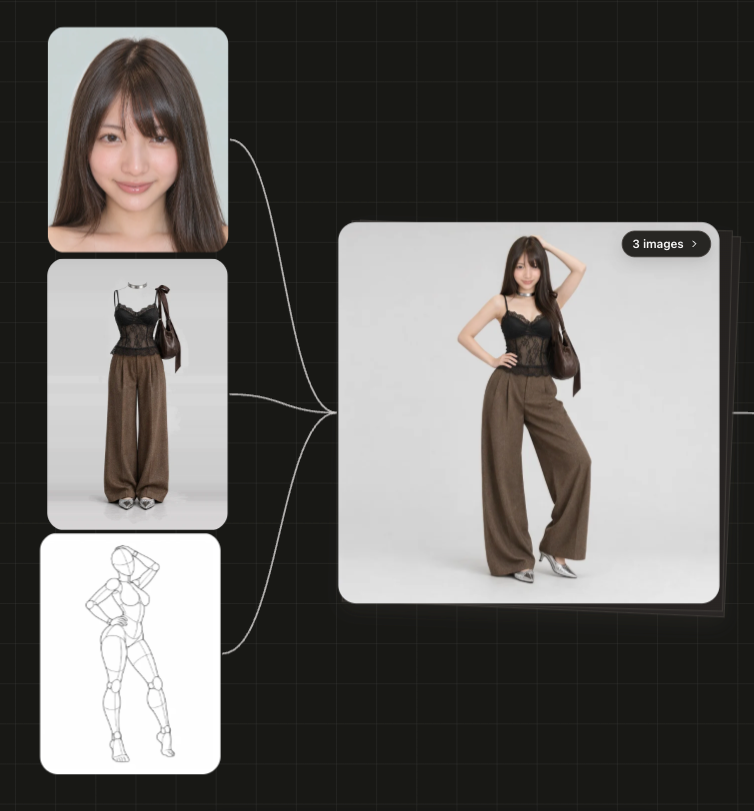

# AI Girls Gallery

[English](README.md) | **中文** | [日本語](README.ja.md)

面向 AI 图像和视频创作的中英日三语参考图资料库。把人物面部、服装、姿势、姿势深度图四个免费参考图库整合到一个页面，可在线浏览，也可离线使用。

**在线访问：** https://walkershadow.github.io/ai-girls-gallery/

**体验创作：** 可以在 [AI Creator](https://ai-creator.xprismai.com/) 平台组合使用这些参考图，生成自己的作品。

## 样例

从本库选取面部、服装、姿势各一张，合成出的人物形象一致的图片：



## 收录内容

| 图库 | 内容 | 来源 |
|---|---|---|
| 人物面部库 | 1499 张 AI 生成的虚构人物面部（面部 893、造型 606），可按发长筛选，含下载榜 Top10 | [AIモデル顔データベース](https://ai-portrait-gallery.pages.dev/) |
| 服装库 | 1407 张只有服装、不含人物的图片，分 8 类（四季、内衣、派对、泳装、性感） | [COSTUME-DB-01](https://ai-costume-gallery.pages.dev/) |
| 姿势库 | 288 个姿势 × 5 个角度（共 1439 张），无脸灰色人体模型线稿 | [POSE-DB-01](https://ai-pose-gallery.pages.dev/) |
| 深度姿势库 | 同样 288 个姿势 × 5 个角度的深度图（共 1439 张），越白越靠前 | [POSE-DB-02](https://ai-pose-depth-gallery.pages.dev/) |

功能：切换语言（EN / 中文 / 日本語），可用任一语言搜索，按分类筛选，查看详情并切换角度；“关于”面板里有各原站的使用提示和规则。

部分姿势名称描述的是成人向、亲密类姿势。所有人物均为人体模型或 AI 生成的虚构人物。

## 使用方式

- **在线：** 打开上面的链接。本仓库只收录缩略图，详情大图和“下载原图”都直接从作者源站加载（在新标签页打开后另存即可）。
- **本地：** 克隆仓库后用浏览器打开 `index.html`，不需要服务器，也不需要构建。如果你在 `portrait/img/full/`、`costume/img/`、`costume/png/`、`pose/img/`、`depth/img/` 下存有原图，页面会优先读取本地，读不到时自动回退到源站。

```bash
git clone https://github.com/walkershadow/ai-girls-gallery.git
```

原图不在本仓库中，也不会打包分发，请到原站逐张获取。

## 版权与授权

**图片版权不属于本仓库。** 所有图片归原作者所有，经作者授权在此转载：

| 图库 | 作者 | 原站条款 |
|---|---|---|
| 人物面部库 | あぎ（[@agi_aibusi](https://x.com/agi_aibusi)） | CC0 1.0，可商用、编辑、参考；作者请求不要再分发图片数据本身。 |
| 服装库、姿势库、深度姿势库 | ギア（[@giaaibusi](https://x.com/giaaibusi)） | 可免费用于自己的创作，含商用；禁止再分发、转载、转售或批量下载图片数据。 |

两位作者已授权本仓库所有者在此转载这些图片。**该授权仅限于本仓库，不会转移给你。** 使用这些图片时：

- 请把它们作为自己创作的参考，并遵守各原站的条款。
- 不要从本仓库或其镜像批量下载、再分发、转载或销售图片。
- 不要用于表现真实人物或未成年人、冒充他人，或违背公序良俗的用途。

所有人物、服装和人体模型都是 AI 生成的虚构内容。服装图由文字生成图像制作，未使用真实商品照片。原站不对图片提供任何担保。

本仓库中的页面代码、译文和脚本由 [walkershadow](https://github.com/walkershadow) 编写。每个图库的“关于”面板都以三语完整引用了原站规则。

**致原作者：** 如需修改或删除任何内容，请提交 issue，会尽快处理。

## 目录结构

```
index.html              页面（file:// 和 GitHub Pages 均可使用）
assets/app.js           页面逻辑
data/                   生成的元数据、译文和界面文字
source/                 原站的网页和元数据
tools/build.py          从 source/ 和 tools/i18n_*.tsv 重新生成 data/*.js
tools/i18n_*.tsv        翻译表（日文 → 中文 / 英文）
portrait/ costume/ pose/ depth/   图片
```

修改译文时，编辑 `tools/i18n_*.tsv` 后运行 `python3 tools/build.py`。
